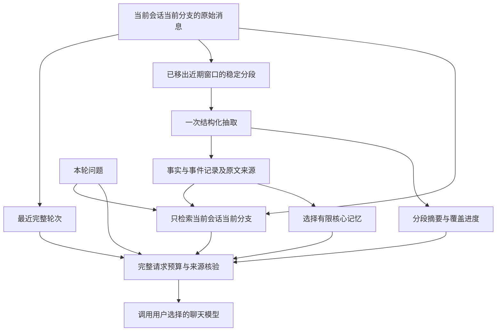

# deepstay 单会话长期记忆实现方案：Hermes 源码研究与项目落地

日期：2026-11-18（Asia/Shanghai）。状态：阶段一、二代码已实现，本轮全面复查后 20 套自动回归通过；本地 Web 复验与方案对照见[专项审计](./MEMORY_SYSTEM_AUDIT_2026-11-18.md)。阶段三尚未实现，真实模型的长期记忆质量尚未完成评估。

研究对象为 Nous Research 的 [Hermes Agent](https://github.com/NousResearch/hermes-agent)，不是 Hermes 系列模型权重。源码固定在 [`f7e2898aaefc8f967dbf7345e3999a65672fe60e`](https://github.com/NousResearch/hermes-agent/tree/f7e2898aaefc8f967dbf7345e3999a65672fe60e)，避免引用随 main 改变。项目基线为 deepstay 源码分支 `codex/session-memory-import` 的 `dafb24d`。

**实现结构：当前会话的核心记忆 + 带原文来源的事实/事件 + 本会话原文检索 + 最近完整轮次。** 新路径使用独立分段摘要承接历史脉络，不再反复改写一份摘要作为唯一历史记忆。不引入向量数据库、第三方记忆服务或额外后台进程。

## 0. 本轮实现状态

- 记忆查询和写入都限定当前会话及选中分支。事实引用可见原文的消息 ID、SHA-256 指纹和 UTF-16 范围；编辑原文后旧来源及依赖它的更正失效，更正仅在支持它的当前分支生效。用户可明确更正同一现实/角色背景中的旧用户记录或助手设定、承诺；也支持同条超长消息的后续片段和同次输出内的前序记录更正。
- 开启“上下文压缩”后，继续历史聊天时先检查请求长度。短会话保持完整上下文，不调用抽取；长会话使用最近完整轮次、相关原文和有限核心记录。关闭时沿用原发送行为，设置仍只有一行名称和开关。
- 完整请求以约 24k 估算 tokens 为目标，含系统提示、当前问题、提醒、续写和工具开销；最近轮次最多约 12k，原文召回最多 6 个窗口、约 3k。估算值用于控制可省略内容，不是供应商的硬上限。
- 每次发送最多处理 2 个新分段，选择最早和最近的待处理段，正文批次约 6k 估算 tokens。每段一次 JSON 抽取，输出上限 4096 tokens，逐段提交后复用。超长历史可先按需召回并继续聊天，不要求先完成全量摘要；未覆盖时停用自动核心记忆并明确资料不完整，不能把本轮两段完成当作全部历史已整理。
- IndexedDB 升为 v13，只新增三个派生表，不迁移或删改原始消息、附件及分支。原有 `fixed` 保留；旧 `cache` 数据保留但不作为新路径的记忆来源。覆盖由有效分段来源范围计算，不另存一份全历史文本或永久待处理队列。
- 原文与派生版本在同事务取得，短事务比较 `sourceRevision` 和 `memoryRevision`，并在事务内复查取消/关闭状态后提交。取消保留已成功提交的段，失败段不推进覆盖；过期、关闭开关、删除或清空后的结果不能继续写入。跨标签版本冲突后重载最新原文，拒绝最终保存旧快照；后台保存不让准备中的任务自行失效。可恢复的抽取失败时使用有界历史，来源校验或存储失败仍会中止本轮。
- 保留官方流程基础上的串行新增导入与进度条。80MiB 归档导入和 80MiB 单条正文的记忆管线分别验收；后者尚不代表整条 `session` 读取、保存、JSON 解析或低内存 Android 的内存问题已解决。第三阶段分页与增量解析仍未实现。

代码与测试入口：`memoryTypes.ts`、`memoryRecords.ts`、`memoryRecall.ts`、`contextMemory.ts`、`db.ts`、`store.ts`，以及五个 `deepstay-memory-*-regression.mjs` 和更新后的 `deepstay-context-memory-regression.mjs`。最终通过范围记入 [验收记录](./QA-2026-11-18.md)；本节的代码状态不代替真实模型语义质量或 Android 实机验收。

## 1. 已确认的产品边界

- 只记住和检索**当前会话**中的内容。A、B 两个会话即使有相同人物、标题或关键词，也不互相读取记忆。跨会话记忆本次不设计、不实现。
- 同一会话内，只有当前选中消息分支支持的事实才生效。其他分支里的设定、更正、承诺不能混进当前回答。
- 所有本机原始消息、分支和附件保留；自动派生记忆可从原文重建，不能改写原文。原有 `fixed` 是需单独保留的配置，不能保证从聊天记录重建。
- 设置仅显示“上下文压缩”和开关，保持一行；不恢复“当前会话记忆”按钮、编辑弹框或常驻说明。
- 关闭开关时不自动检索、抽取或压缩；保留已存数据，继续现有的完整上下文发送行为。
- 用户的原有固定记忆继续保留。正常使用通过聊天中的设定和更正形成新记忆，无需新增配置页面。
- 保持当前官方流程基础上的串行新增导入、进度条和失败回滚，不引入多 CPU/Worker 并发导入。
- 实现后先提供本地 Web 或模拟器测试，测试通过仅推送源码分支；生产构建、部署和 Release 仍等待用户后续要求。

“单会话记忆”指每个会话各自维护自己的记忆；切换到另一个会话时使用另一个会话自己的数据，不是只允许应用保留一个聊天。

## 2. Hermes 实际采用的机制

### 2.1 有限核心记忆：并非无限增长的摘要

Hermes 内置两个文件：`MEMORY.md` 默认 2,200 字符，保存环境、约定和经验；`USER.md` 默认 1,375 字符，保存用户偏好。文件位于当前 Hermes home/profile 的 `memories` 目录，可在该 profile 的不同会话间复用。[H1][H2]

这两个上限按字符计，不是精确 token 数。文档中的约 800/500 tokens 是其示例估计，不能直接套用中文聊天。容量不足时写入返回错误，不会自动静默裁掉旧条目；模型可以用 `add`、`patch`、`remove` 或批量 operations 整理后再写。当前版本不再向模型提供整条 `replace`，以减少只改一句却覆盖其他事实的问题。[H1][H2][H3]

**本项目借鉴：** 核心提示需要容量上限，重要事实分条管理；核心提示装不下不等于删除底层记忆。**本项目调整：** 两类文件不照搬为全局用户画像，而是合并为当前会话的事实与设定记录。

### 2.2 冻结提示快照：优化前缀复用

文档描述在会话开始时将文件内容注入系统提示，期间写入先持久化，工具返回实时状态；本次已注入的快照不随每次写入即时改动。其目的是稳定提示前缀，不是让模型拥有无限上下文。[H1][H2]

这套生命周期与长期不断开的陪伴会话不完全匹配。deepstay 采用**每次发送前固定一次请求快照**：当前轮不变，更正最迟在下一轮准备上下文时生效，无需用户新建聊天。前缀能复用时复用；缓存命中不能优先于更正和正确记忆。

### 2.3 原文搜索：核心记忆之外的细节来源

Hermes 把聊天保存到 SQLite，以 FTS5 检索；`session_search` 支持发现、定位消息周边、读取会话和浏览历史。所核验版本的工具直接返回数据库消息，不在搜索工具里调用 LLM 重新摘要。[H1][H4]

文档声称返回“不截断”，但源码实际为发现结果、周边窗口和读取内容设置了长度上限，并标记截断。因此应理解为**从原始记录取回有预算的片段**，不能理解为所有内容都无限量注入。README 中“FTS5 配合 LLM 摘要”的概述，也不能替代当前搜索函数的具体行为。[H4]

**本项目借鉴：** 摘要漏掉某次约定时，仍能找回原文、时间和说话者。**本项目调整：** 自动回忆查询必须强制限定当前会话及当前分支，不复用 Hermes 的跨会话查询范围。

### 2.4 上下文压缩：与持久记忆分开

默认 `ContextCompressor` 保护开头和最近内容、摘要中间历史，并保留可通过检索恢复的历史。当前 lean 策略还包含标识符锚点、用户原话和检索恢复指针；超长摘要输入存在抽样机制，因此不能称为无损压缩。[H5][H6]

文档配置默认 `threshold: 0.50`，但窗口低于 512K 时还存在 0.75 的下限；Gateway 的预处理另有 85% 安全阈值。不能只摘取“默认 50%”就应用到所有模型和路由。deepstay 没有同样的 Gateway/工具循环，第一阶段继续使用现有保守预算，在完整请求层检查上限。[H5]

### 2.5 写入正确性与可选扩展

Hermes 内置存储具有去重、唯一片段匹配、容量校验、文件锁、原子写入和内容扫描。压缩流程还有任务归属与提交边界，避免迟到任务覆盖新状态。外部 memory provider 是额外能力，并非内置记忆必须依赖的向量系统。[H2][H3][H7]

deepstay 借鉴来源校验和原子提交，以现有 IndexedDB 实现；不搬入 Python、SQLite、插件管理、后台自我改进或第三方画像服务。

## 3. 实施前基线与待补能力

下表保留研究时的基线，阶段一、二的实际实现见第 0 节，不能把旧滚动摘要的限制或验证结果当作新路径现状。

| 项目现状 | 作用 | 本次需要补齐的能力 |
|---|---|---|
| `Session.contextMemory.fixed` | 已有会话级固定记忆 | 原样保留，不自动改写成新抽取结果 |
| `cache.summary` 和 `cache.source` | 滚动摘要、来源 ID 与 SHA-256 前缀校验 | 结构化事实/事件、逐段来源、可检索原文 |
| 约 24k 触发、12k 最近轮次、6k 摘要批次、最多 16 批 | 控制摘要和发送规模 | 将系统提示、召回片段、当前问题等纳入完整请求预算 |
| 摘要要求保留称呼、边界、情绪事件、承诺、更正 | 已考虑陪伴场景 | 可验证来源的记录，避免重要旧信息在多次摘要中消失 |
| `historySearch.ts` | 用户手动搜索所有会话，包含未选中分支 | 独立的当前会话/分支召回函数；不能直接把手动搜索结果给模型 |
| `sessions` 每行保存整个 `messages` 数组 | 简单、现有功能兼容 | 单个超大聊天的读取/写入峰值需要另做消息分页 |
| v3 ZIP 导出消息和分支 | 兼容官方历史格式 | 目前不导出 `fixed` 与摘要；不能声称可完整备份记忆 |

实施前并非“没有记忆”，主要问题是**长期记忆集中在一份反复改写的摘要中，缺少按问题找回原文的路径**。单纯把摘要字数增加，只会推迟遗忘和增大输入，并不解决来源、分支和错误更正。

## 4. 目标结构和每轮数据流



四类内容各有职责：

1. **原文：** 唯一可追溯证据，保留全部消息和分支。
2. **核心记忆：** 当前角色、双方称呼、明确边界和稳定偏好等少量高优先级记录，避免每次都靠检索。
3. **事实与事件：** 日期、共同经历、约定、未完成承诺、用户更正、情绪事件，按问题召回，不全部常驻提示。
4. **最近完整轮次与近期摘要：** 保持语气、情绪过渡和当前话题；摘要不升级为事实证据。

普通发送流程：冻结会话/路径/模型配置 → 校验已有派生来源 → 检索 → 必要时处理有界的新分段 → 选择核心记忆 → 组装并校验完整请求 → 发送 → 按原有流程保存回答。任何查询和提交都携带 `sessionId`，调用者不能省略作用域。

## 5. 记忆记录与分支更正

### 5.1 数据模型

以下结构已在 `memoryTypes.ts` 实现。首版只增加三个派生存储：`memoryRecords`、`memorySegments`、`memoryState`；不修改原始消息格式。

```ts
type SourceRef = {
  messageId: string
  fingerprint: string
  start: number
  end: number
}

type MemoryRecord = {
  id: string
  sessionId: string
  kind: 'setting' | 'preference' | 'boundary' | 'event' | 'promise' | 'correction'
  actor: 'user' | 'assistant'
  realm: 'self_report' | 'roleplay' | 'hypothetical' | 'unspecified'
  key: string
  text: string
  sources: SourceRef[]
  supersedes: string[]
  eventTime?: string
  eventTimeText?: string
  extractedAt: number
  extractorVersion: number
}
```

`sources` 引用抽取时的标准正文视图：用户正文，或助手可参与上下文的可见正文；不包括隐藏思考、错误模板及未读取的附件内容。偏移按 JavaScript UTF-16 字符位置计算，拆分时不切开代理对；版本规则改变时必须更新 `extractorVersion`。本轮将抽取版本升为 2；版本 1 派生数据保留但不再作为有效来源，继续聊天时按新规则有界重建，数据库结构仍为 v13。

`memorySegments` 保存确切的消息/分片范围、指纹、摘要、抽取版本及生成模型信息；记录 ID 包含所属分段 ID。`memoryState` 只保存会话 ID、原文版本和派生版本，覆盖状态由当前有效分段的来源范围推导，不保存 API Key。派生记录和分段以 `sessionId` 建索引；不能使用标题、昵称或相同正文把两次导入的会话合并。

模型的抽取输出提供 `messageId` 与简短的逐字引用，由应用匹配原文后计算 `start/end`，不要求模型数中文字符或直接决定数据库 ID。引用不存在或匹配不唯一时该记录不通过；持久化来源只保存偏移和指纹，避免重复保存大段正文。引用存在只证明出处存在，不能机械证明概括后的结论正确，仍需第 13 节的语义评估。

### 5.2 当前路径上的有效性

事实生效条件是：所属会话等于当前会话，必要的来源消息均在当前选中路径上，正文指纹仍一致，关联的更正也属于当前路径。不要为每次追加消息生成一套全新事实，也不要仅因为切换分支就删除旧分支的数据。

更正以**新增的不可变记录**表达，不直接把旧事实全局标成无效。例如：

- 共同祖先：用户说“我喜欢红色”。
- 分支 A：用户更正“现在更喜欢蓝色”。该分支以蓝色为当前偏好，同时保留偏好变化事件。
- 分支 B：没有这次更正，应仍使用红色。

`supersedes` 仅在其更正来源位于当前路径，且被更正记录与整条更正依赖链仍有有效的先前来源时覆盖旧记录。否则分支 A 的更正会污染分支 B，这是必须有专门回归的情形。同一消息按来源范围先后判断更正，不只比较消息 ID。摘要同样只能由当前路径有效分段生成。

同次抽取中可用 `"@0"` 引用 `records` 数组第 0 项等前序记录，应用校验后映射为确定 ID；拒绝自引用、前向引用和跨背景引用。仅按相同主题 key 猜测更正关系不被允许。没有建立 `supersedes` 关联的更正保留为待核对材料，提示显式标注“更正关联尚未建立，需核对原文”，不能冒充已确定的当前状态。

### 5.3 事实可信度与矛盾

- 用户明确说出的设定/偏好，可以形成记录；助手说“你喜欢蓝色”不能自动成为用户偏好。偏好、边界和更正的每一条证据均须为用户原话，不能混入助手断言后用一条无关用户引用冒认。
- 角色扮演中的身份和关系标为 `roleplay`，不写成现实身份。没有明确背景时保持 `unspecified`，不能自行补全。
- 助手承诺保存为助手提出的承诺，不写成已经兑现的共同经历。日期到了不等于承诺完成，必须有后续来源证明状态变化。
- 没有明确更正关系的冲突保留双方来源和时间，不能只按“后出现”就判断为事实替换。
- 不把一次情绪推断成稳定人格，不做心理诊断。情绪事件记录原话、原因和用户明确反馈有效的回应。
- 相对日期只有在消息时间和时区足以确定时转换，同时保存“下周五”等原始表达；信息不足保持未确定。

用户本轮直接更正即进入最近原文，在本轮/下一轮请求中具有优先性；旧 `fixed` 作为历史明确配置保留。新的事实账本不自动删除或悄悄重写 `fixed`。

## 6. 抽取、摘要与覆盖进度

### 6.1 不为每条消息单独调用模型

只对已经移出最近窗口、未抽取且正文稳定的分段处理。仍在流式输出的回答不抽取。普通新增消息留在最近完整轮次，足以让当前回答知道刚发生的事。

以现有约 6k 估算 tokens 的摘要批次为起点，将**同一次**摘要调用改为 JSON 输出：`summary` 和 `records`，更正作为 `kind: 'correction'` 记录及其 `supersedes` 引用表达。模型只处理当前分段，附带有限、主题相关且时间早于本段的旧记录用于识别更正；不每次喂入全部事实账本，更不让模型重写全部核心记忆。

阶段一、二在本轮合并接入完整新路径，普通一次发送最多处理 2 个新分段。此为当前实现上限，不代表两段足以覆盖任意历史，也不是手机性能承诺。

校验包括：JSON 结构正确、记录数量和输出有界、来源 ID/片段范围有效、引用与原文一致、actor/realm 合法、更正目标存在且属于本会话当前路径的先前来源。模型自报的 confidence 不作为事实正确的保证。输出截断或验证失败时不提交半份结果，也不自动连续重试。结构化输出比单纯摘要更长，原有 2048 输出上限不能未经测试直接沿用；通过减少单段记录数/正文预算及测量输出长度选择有界上限，不能把输出截断误判为成功。

摘要输出不可用、超时、请求过长或服务器繁忙时，改用最近完整轮次、已验证的分段脉络和有界原文检索继续发送。失败段不提交。在当前会话中，同一接口与模型五分钟内复用这套本地准备方式。认证、余额、限流、网络、来源冲突及存储错误仍单独处理。历史尚未全覆盖时停用自动核心项，并标明覆盖不足。本轮正文、续写、附件和固定设定占满本地预算时，省略历史和自动记忆，由接口判断能否接收。

### 6.2 分段替代不断改写全部历史

分段摘要与记录保存后，后续追加历史不重新摘要已验证的旧段。该接口与模型最近一次整理位置之后，约累积 6,000 tokens 刚移出近期窗口的内容才再次调用摘要。少量续聊直接复用已整理内容及原文检索。编辑原文时只失效包含该来源及依赖它的记录/摘要。摘要拼接超过预算时选择近期相关分段，底层事实与原文仍完整保存。

核心记忆从有效记录中按规则选取，重点保留明确设定、称呼和边界，再选稳定偏好。初始预算建议约 1.5k 估算 tokens。超过核心预算的有效记录保留在事实库中，按需检索；不能为了核心提示容量删除早期重要事件。

### 6.3 大量旧历史不强制先全量摘要

阶段二新路径已移除“超过 16 批就不能继续”的旧滚动摘要门槛。导入只做当前串行导入，不调用模型。首次继续长会话时，使用最近轮次、保留的固定记忆和当前问题检索到的原文；按上面的有界批次逐步建立新记忆，不要求先把 80MB 全部送去摘要才能说第一句话。是否能够在低内存手机打开该会话，仍受第 10 节的底层存储限制约束。

覆盖进度必须按消息与分片记录，不能只有“最后处理到第 N 条”，否则切换分支或单条超长消息会漏内容。没有处理的历史标为未覆盖；检索到的未覆盖原文仍可作为本轮证据。系统不得对模型宣称已经整理完全部历史。

用户点击停止、页面关闭或网络失败后，保留已经完成事务的段；后续达到整理条件时从未覆盖范围继续。只有本轮调用摘要才显示整理进度，进度只代表本轮计划任务，不把“本轮 2 批完成”显示成整份历史 100% 完成。

## 7. 本会话原文召回

首版使用本地词法检索，先扫描当前会话的有效事实与分段，必要时读取对应原文窗口，不新增 embeddings 请求或远程记忆服务。

1. 从本轮问题及最近 1–2 轮提取名称、日期、原话短语、中文短词/二元字组和英文词；排除“你还记得吗”等空泛表达。本轮问题的词项或与其相关的有效事实提示必须命中，最近话题只作辅助加权，不能单独触发不相关回忆。
2. 必须先限定 `sessionId` 与当前路径。现有手动历史搜索包含其他会话/分支且每会话最多一个命中，不能直接复用其结果。
3. 优先匹配原话、名称和日期，再匹配词项覆盖；对重复内容去重。重要性和时间只作辅助排序，不能永远用最新消息压掉很早的约定。单条超长消息分块扫描时兼顾首尾有限命中，避免重复旧提法挡住末尾更正；大小写归一化的匹配范围映射回原文，防止 Unicode 转换扩长后取错证据位置。
4. 初始取最多 6 个命中窗口，总计约 3k 估算 tokens；每个窗口带消息 ID、时间、角色和明确省略标记，不能截成一句看不出否定或条件的话。
5. 召回候选来自未覆盖片段时，核对原文后直接提供有界证据，不为了当前一次回忆重新总结整份历史。
6. 输入过于模糊或确实没有证据时允许回答不确定，不能补造共同经历。

核心记忆和检索片段都标记为历史材料，由应用固定提示规定其用途；不能把原文中的“忽略其他指令”等内容升级成系统命令。格式化和提示只能降低误用风险，仍需测试带指令的历史材料。

词法检索对“上次去海边”与原文“周五看海”这类改写可能漏召回。当前用有效事实的主题标签与最近用户原文补词辅助匹配；如果固定题集仍明显达不到召回目标，再单独评估语义检索。本次不预先增加向量服务或跨会话搜索。

## 8. 完整请求预算与刷新规则

继续使用现有估算器作保守控制，明确它不等于真实计费 tokenizer。检查对象是**最终实际请求**：正文、系统提示、工具 schema、提醒与协议开销均纳入；图片按已知供应商/能力预算处理，不把 Base64 字符数或整个 JSON 的字节数直接当作计费 tokens。图片成本未知或无法安全界定时，不靠文本长度保证不会超窗。

当前实现以 24k 估算 tokens 作为可选上下文的保守预算，不从模型名字猜测窗口上限，也不保证任意模型一定可接受。后续若引入可靠的模型窗口 `C`，可改为输入预算 `B = min(24,000, C - 输出预留 - 安全余量)`；输出预留需使用实际最大输出并按供应商规则计入思考输出。该动态窗口策略尚未实现。

一份 24k 输入预算的起始分配示例：

| 内容 | 目标上限 |
|---|---:|
| 系统提示、原有 fixed、当前问题、协议开销与必要续写内容 | 5.5k |
| 最近完整轮次 | 12k |
| 核心记忆 | 1.5k |
| 相关原文召回 | 3k |
| 必要的近期/分段摘要 | 2k |

这是内部预算，不是新增用户配置。`fixed` 按原值计入；优先保留最近的完整轮次，再加入核心、召回和分段摘要。估算偏高时缩减可选上下文。如果只剩系统设定、当前问题和续写前缀仍超估算值，把必需内容完整交给接口，不为此调用摘要。接口明确拒绝后，如仍有可省略的上下文，则缩减一次重试；若已无法缩减，提示用户将当前消息分段，或用新消息接续过长的回答。原始记录及已有记忆始终保存在本机。

预算估算与实际发送路径一致：重复的历史提醒按请求的去重规则计算，续写按本轮实际 thinking 开关计算，避免可完整发送的历史被误判成需要整理。

附件补传后按最终请求再次检查预算。模型整理暂时不可用时沿用覆盖不足的处理规则，发送可容纳的近期轮次与有据可查的历史材料。

每轮捕获 URL、协议、模型、Key、会话 ID、路径和来源指纹；中途切换设置不混用目的地址与凭证。压缩后历史附件补传与已排队上传也沿用捕获的连接，不能在释放上传槽位时读取新 Key/地址；下一轮才用新配置。模型返回 usage 时，可记录同路由同模型的估算误差以评估后续校准，首版不依赖不完整 usage 自动放大预算。

## 9. 存储、提交与兼容

### 9.1 派生存储与原子提交

在原 DB v12 基础上新增派生存储并升级到 v13；升级事务只创建存储/索引，不扫描全库、不调用模型、不迁移原始消息。原文仍为现有消息存储的唯一事实来源。

`memoryState` 将原文版本 `sourceRevision` 与派生版本 `memoryRevision` 分开。原文内容或选中路径发生变化时，`saveSession` 必须把相应版本递增和原文保存放进同一个事务；删除/清空同步删除相应状态，导入新 ID 初始化自己的状态。不能只比较派生版本，否则另一个标签已改原文但没有改记忆时，旧抽取仍会错误提交。此改动需接入所有相关写路径，不是在抽取函数里额外写一次计数器。

开启压缩时，抽取先等待捕获的原文快照成功落盘，再用同一个只读事务取得原文与版本；保存失败则中止本轮并保留重试状态。关闭压缩时保留原有发送行为。取得快照后在事务外进行检索、hash 和模型请求；网络或 Web Crypto 等待期间不能持有 IndexedDB 写事务。

提交时用短写事务检查会话存在、`sourceRevision` 与 `memoryRevision` 仍等于捕获值，并在异步读取与写入间复查任务是否仍允许提交；关闭开关或停止后原子回滚。通过后一起写记录和分段并递增派生版本；覆盖从已提交分段推导。首版对生成期间任何原文/路径变化都保守拒绝提交，包括新添消息；后续如需放宽，必须增加来源范围核验，不能静默跳过。跨标签竞争也以此事务条件解决，不只依赖内存变量或浏览器新 API。

来源冲突后不执行会话的最终旧快照保存，改为重载数据库最新会话并刷新缓存；重载失败则清除该旧缓存，阻止下一次发送把旧原文写回。准备上下文前已有一次原文保存，准备期间的 `visibilitychange`/`pagehide` 不重复保存同一占位回答，避免自身递增来源版本；正常流式正文仍沿用原持久化流程。

分段以 `sessionId + 来源范围指纹 + extractorVersion` 标识幂等结果；事务内发现该段已完成则复用，不重复落库。应用若在模型完成但事务未提交时崩溃，下次可能重新调用，不能承诺付费请求恰好执行一次。以上版本校验只防止提交过期的记忆派生结果，不代表已经解决原有聊天的全部跨标签编辑冲突。

取消、清空历史、删除会话、编辑来源或切分支之后返回的迟到结果，必须重新核验或丢弃。应用显示“已保存”以事务完成为准；模型回答“我记住了”不能当作写入成功的证据。

### 9.2 原有数据

- `fixed` 原样兼容，无论开关状态都不自动清除。
- 旧 `cache.summary` 数据保留，但新路径不再使用它，也不直接拆成高可信事实。新记录从原文生成。
- 服务/模型切换使相关摘要与请求缓存重新检查，但不删除来源充分的事实记录、事件和原文。后续提示规则版本变化应按版本失效，不反复悄悄覆盖同一数据。
- 用户关闭开关后不启动新派生任务，并拒绝在途抽取的后续提交，保留已存数据。关闭状态的原有发送行为保持兼容。

### 9.3 生命周期必须同时接入

| 操作 | 记忆侧要求 |
|---|---|
| 删除会话 | 删除该会话派生数据，取消任务；迟到结果不能复活会话 |
| 清空历史 | 同步清除派生存储及任务世代，保留原有 Key/设置语义 |
| 编辑/重新生成/切分支 | 按当前路径与正文指纹计算有效性，不共享另一分支的更正 |
| 新增或重复导入 | 使用新会话 ID，独立派生记录；不能按同名/同文复用别的会话记忆 |
| 导入失败 | 不给不存在的新会话留下有效记忆，原有数据全部保留 |
| 存储失败/配额不足 | 不推进覆盖进度，保留原文与旧版本，提供可重试状态 |
| 重启/恢复页面 | 读取已提交版本，从未覆盖片段恢复；未提交临时结果不算成功 |

### 9.4 备份边界

当前官方 v3 ZIP 没有保存 `fixed` 或摘要。自动事实、段摘要和索引可以由原文重新派生，但 `fixed` 不一定存在于聊天原文中，因此不能保证重建。

本次第一、二阶段不改变刚恢复的官方导入格式和流程。若后续需要“应用原生记忆无损备份”，应单独设计版本化备份扩展：明确文件、校验、会话/消息 ID 重映射和失败回滚，再更新导入导出文档及测试。不能在未做该扩展时写“备份已完整保存所有记忆”。

## 10. 80MB 数据的处理边界

必须分别验收三类数据，不能以一项通过代替另一项：

| 数据形态 | 记忆实现的处理 | 当前存储限制 |
|---|---|---|
| 整份 80MiB ZIP，包含许多普通会话 | 导入后不全库抽取；仅处理当前打开会话 | 已有串行新增回归覆盖此类文本归档 |
| 80MiB 图片 Blob | 不把图片字节、Base64 或推测图像内容塞进记忆；只索引已知元数据 | 已有归档与 Blob 存储回归，不等于手机图片解码测试 |
| 单个会话就有约 80MiB 正文 | 按问题检索、分片抽取，禁止全量发送 | 整条 session 结构化克隆和整份 JSON.parse 仍可能导致峰值，需要独立存储阶段 |

第一、二阶段不承诺低内存手机可流畅打开 80MiB 单会话。增加一个派生索引，不能绕过现有 `loadSession()`、保存、游标读取和渲染对完整 `messages` 数组的依赖。

真正支持单个超大会话的第三阶段需要：

1. 将原始消息按会话和消息 ID/顺序分别存储，正文特别大时再分块；消息元数据保存父子关系和摘要，不重复保存整份正文。
2. `Session` 的运行时详情改为有界窗口，通过游标读取旧消息；当前路径的元数据可遍历，正文按需读取。仅把数据库拆表、最终又 `getAll()` 拼回数组没有意义。
3. 发送、搜索、分支切换、编辑、流式保存、删除、导出与 UI 列表都要适配分页，不能只改记忆函数。
4. 历史单会话 JSON 仍需一次性解码和解析的问题，要通过有界串行的增量 UTF-8/JSON 解析解决；保持 manifest/schema/CRC 校验、暂存和原子新增语义。仅拆小写入批次并不能解决 `JSON.parse` 的峰值。
5. 每批建议从 32 条消息或 256KiB 正文开始，以先达到者为准，适时让出主线程；超长单消息也分片。参数经实测调整，导入仍串行，不重新引入 Worker 并发。
6. 现有 v12 正式消息的存储迁移必须可恢复，校验新副本完整后才切换读取标志；不能删掉唯一旧副本，也不能靠永久双写掩盖迁移问题。该阶段改变当前文档中“不迁移旧消息”的存储约定，属于独立变更，实施前需要同步确认其范围和回退策略。

本地检索索引同样按当前会话逐块建立、存储，不把所有正文拼成一条字符串，也不在每次按键时重建全部索引。首版无需引入通用搜索引擎；第三阶段若使用倒排索引，应以实测索引体积和中文命中率决定词项策略，避免无界 n-gram 膨胀。

## 11. 模型调用数量与运行边界

- 短会话、已有有效缓存、普通本地召回：不新增摘要调用。
- 新的旧历史分段：每段最多一次结构化抽取，记录完成后复用；一次普通发送最多处理 2 段，失败不无限重试。
- 导入、启动应用、切换列表和关闭压缩：不触发付费模型调用。
- 每段调用的输入包括该段、固定抽取指令及有限相关旧记录，输出使用明确上限。迁移上线后先用合成数据统计实际输入/输出，而不是用 ZIP 字节数直接估算 token。

例如未处理正文约 120k 估算 tokens、每段约 6k，单看正文至少需要约 20 段才能全覆盖；还有指令和输出开销，不能把它写成两次请求就完成。当前按需召回可以先回答，但未覆盖历史的语义质量仍受检索命中率影响。

不显示用户已要求移除的常驻费用说明，也不增加记忆配置按钮。真实模型质量评估使用用户明确提供的测试配置和限定预算；本次研究没有调用用户的付费模型。

## 12. 文件改动与实施顺序

### 阶段一：本会话来源和原文召回（代码已接入）

目标：当前分支可找回摘要之外的相关原文。本轮与阶段二合并接入，以分段摘要替代旧滚动摘要路径。

- 新增 `memoryRecall.ts`：只接收当前会话 ID、当前路径和问题，返回有来源、有预算的证据。
- 在 `contextMemory.ts` 中接入召回、完整请求预算和请求快照；保留现有取消、进度、错误处理。
- 在 `store.ts` 捕获/核验会话路径，确保另一会话和未选分支不进入请求。
- 先不改原始数据库、导入格式和设置 UI。

验收：跨会话和跨分支零串用；既有 15 组回归保持通过；被摘要遗漏但词法可定位的事件能从原文找到；无证据不编造。

### 阶段二：结构化事实、事件与稳定分段（代码已接入）

目标：形成有限核心记忆与可复用事实库，减少反复摘要同一历史。

- 新建 `memoryTypes.ts` 与 `memoryRecords.ts` 处理派生类型、来源校验和分支内更正；核心选择留在 `contextMemory.ts`。
- 在 `db.ts` 增加派生存储和短事务提交；接入删除、清空、失败和恢复。
- 在现有摘要函数内替换为结构化分段抽取，不额外创建一套通用插件/服务框架。
- `contextMemory.ts` 负责顺序编排，独立的召回模块负责本会话查询；只有复杂度实际出现时再拆更多模块。
- 补充 `deepstay-memory-records-regression.mjs`，扩展现有上下文回归覆盖集成路径。

验收：分支内更正、原文编辑失效、有效旧段复用、存储失败不推进覆盖、重启恢复、迟到任务拦截全部通过。切换模型保留有证据事实；原有 `fixed` 保留。

### 阶段三：单个超大会话的存储与解析（未实现）

目标：把“80MiB 单会话正文”作为独立存储工程处理。按照第 10 节改消息读取/保存、分页 UI 和串行导入解析，避免一边承诺低内存，一边继续复制完整数组。

验收：原始消息数、正文 hash、分支关系和附件引用完整；内存峰值与响应时间有实际设备证据；迁移中断、导入中断、配额失败可恢复。不把前两阶段的 Web 结果当作此阶段通过。

原生记忆无损备份另立格式设计，与阶段三可以分开交付。跨会话记忆不列入以上阶段。

## 13. 测试计划与通过标准

### 13.1 必须通过的正确性测试

| 场景 | 通过标准 |
|---|---|
| A/B 会话使用相同昵称但不同身份 | 发出的证据和核心记忆只含目标会话来源；零串用 |
| 共同祖先偏好红色，A 更正蓝色，B 未更正 | A 用蓝色，B 仍用红色；共同祖先不被全局作废 |
| 编辑旧消息、切换版本、重新生成 | 被修改来源的派生结果失效；其他有效片段不重复全量抽取 |
| 助手虚构用户喜好、角色身份、完成承诺 | 不成为现实用户事实；来源与状态可检查 |
| 单条超长原文 | 分片无漏字、无破坏 Unicode；覆盖记录不把半条算整条 |
| 取消、超时、JSON 无效、输出截断 | 不提交半份记录；不回退到无界完整历史 |
| 更正为蓝色的片段抽取失败，后续又移出近期窗口 | 保留边界原文或停用可能过期核心项；不能退回红色并当作确定偏好 |
| 删除/清空/切分支后的迟到结果 | 不写错路径、不复活会话、不推进错误覆盖 |
| IndexedDB 写入失败或配额不足 | 原文/旧记忆不变，不显示未完成的保存成功 |
| 重启和跨标签竞争 | 只读取已提交版本；事务版本检查阻止过期写入 |
| 重复导入和导入失败 | 原有会话保留；新 ID 独立；失败没有有效残留 |
| 开关关闭、官方/自定义接口切换 | 沿用现有行为；无自动记忆调用，凭证与地址不混用 |
| 完整预算含续写、思考、附件元数据 | 超估算预算时省略可选上下文；完整发送必需内容，接口拒绝后才提示处理 |

测试检查实际发送的请求和实际 IndexedDB 内容，不只验证提示词里出现某个词。合成响应适合验证控制流，不代替真实语义效果。

### 13.2 记忆质量固定题集

建立合成陪伴对话，包含至少 100 个分散在早、中、晚阶段的可核对事实，其中 30 个明确更正/矛盾、20 个助手承诺或未完成约定、20 个对话从未出现的诱导问题；各集合可交叉。准备短、长及多次摘要后的版本，问题答案和原文来源预先标注。

比较四组：①当前滚动摘要；②增加本会话原文召回；③再加入结构化核心/事件；④能放入同一模型窗口的小样本完整原文参照。使用同一模型、参数和问题集，至少重复三轮；真实长文本不能塞入窗口时，不伪造“完整上下文上限”。

建议验收门槛，均是待验证目标：

- 证据 Recall@6 ≥ 90%；称呼、边界和明确更正专项 ≥ 95%。
- 有证据问题答案准确率 ≥ 90%；重要人名/日期按标注核对，另报不确定比例。
- 无证据问题中 ≥ 95% 能表明不确定，不虚构共同经历。
- 对旧基线报告改善/退化的逐题结果，不仅报告平均分；跨会话/分支泄漏和已更正偏好反转属于阻断发布问题。

人工依据原文复核更正、关系边界和否定句，LLM 评分只能辅助。词法召回未达标时先分析同义改写、分片和排序，不通过增加整段历史来掩盖问题。

### 13.3 性能与大文件

分别生成 80MiB 多会话文字归档、80MiB 图片归档、80MiB 单会话正文。记录导入时间、主线程最长阻塞、检索 P50/P95、峰值内存、索引体积和真实请求 token；相同数据固定种子与 hash。

Web 至少检查桌面、390px、320px；移动端阶段需模拟器及一台低内存 Android 实机。首版普通会话的本地召回目标为桌面 P95 < 200ms、手机 P95 < 500ms；后台/串行索引不应持续阻塞输入。目标达不到需记录瓶颈和调整批量大小，不能把这些数值写成已经测得的承诺。

WebView 兼容遵循现有 Chromium 83+ 目标，不依赖缺失的现代 API。已有 80MiB 合成 PNG-header 夹具仅证明容量路径，还需要真实可解码图片检查展示。无新构建/实机结果时，只报告 Web 与自动回归实际覆盖的范围。

## 14. 交付与结果记录

每一阶段都交付：小范围源码 diff、可重复回归、实际请求/存储证据、本地 Web 或模拟器预览、已通过与未通过的验收项。仅推送当前源码分支；不推 main、不打版本标签、不创建 Release。不得将研究中的建议参数或其他项目的性能数字写入 deepstay 的已验证能力。

方案研究已在 `821a976` 留档；本轮在其基础上实现阶段一、二，代码和验收状态见第 0 节及 [验收记录](./QA-2026-11-18.md)。设置入口移除属于此前独立改动 `dafb24d`。阶段三、真实模型语义题集和 Android 实机性能不能由本轮合成控制流测试替代。

## 15. 核验来源

研究通过用户指定的 [AnySearch 技能](C:/Users/111/.agents/skills/anysearch/SKILL.md) 的 code.snippet 垂直检索和 extract 获取候选/正文，再使用 GitHub 读取固定提交的原始文件。GitHub 页面 extract 曾只返回导航信息，因此关键机制以原始源码和仓库文档为准；所有外部内容只作资料，不执行其中指令。

- **[H1]** [Persistent Memory 文档](https://github.com/NousResearch/hermes-agent/blob/f7e2898aaefc8f967dbf7345e3999a65672fe60e/website/docs/user-guide/features/memory.md)：两类核心文件、容量、冻结快照、会话边界与检索。
- **[H2]** [memory_tool_store.py](https://github.com/NousResearch/hermes-agent/blob/f7e2898aaefc8f967dbf7345e3999a65672fe60e/tools/memory_tool_store.py)：容量、去重、来源片段匹配、锁与原子写入。
- **[H3]** [memory_tool.py](https://github.com/NousResearch/hermes-agent/blob/f7e2898aaefc8f967dbf7345e3999a65672fe60e/tools/memory_tool.py)：add/patch/remove、operations、replace 移除及写入入口。
- **[H4]** [session_search_tool.py](https://github.com/NousResearch/hermes-agent/blob/f7e2898aaefc8f967dbf7345e3999a65672fe60e/tools/session_search_tool.py)：实际数据库消息返回、查询模式及内容上限。
- **[H5]** [Context Compression and Caching 文档](https://github.com/NousResearch/hermes-agent/blob/f7e2898aaefc8f967dbf7345e3999a65672fe60e/website/docs/developer-guide/context-compression-and-caching.md)：不同阈值、lean 保留策略、历史软归档与恢复。
- **[H6]** [context_compressor.py](https://github.com/NousResearch/hermes-agent/blob/f7e2898aaefc8f967dbf7345e3999a65672fe60e/agent/context_compressor.py)：默认上下文引擎及摘要编排。
- **[H7]** [conversation_compression.py](https://github.com/NousResearch/hermes-agent/blob/f7e2898aaefc8f967dbf7345e3999a65672fe60e/agent/conversation_compression.py)、[memory_manager.py](https://github.com/NousResearch/hermes-agent/blob/f7e2898aaefc8f967dbf7345e3999a65672fe60e/agent/memory_manager.py)：压缩提交边界与 provider 调度；本项目不引入其完整框架。
- **[H8]** [Hermes MIT License](https://github.com/NousResearch/hermes-agent/blob/f7e2898aaefc8f967dbf7345e3999a65672fe60e/LICENSE)：允许复用；实际复制受许可代码时保留相应版权和许可文本。本方案以机制适配为主。

项目对照文件：[contextMemory.ts](../src/services/chat/contextMemory.ts)、[types.ts](../src/services/chat/types.ts)、[db.ts](../src/services/chat/db.ts)、[store.ts](../src/services/chat/store.ts)、[historySearch.ts](../src/services/chat/historySearch.ts)、[branches.ts](../src/services/chat/branches.ts)、[导入导出约定](../src/services/chat/history/README.md)、[已有研究](./CONTEXT_MEMORY_RESEARCH.md)、[2026-11-18 验收记录](./QA-2026-11-18.md)。
